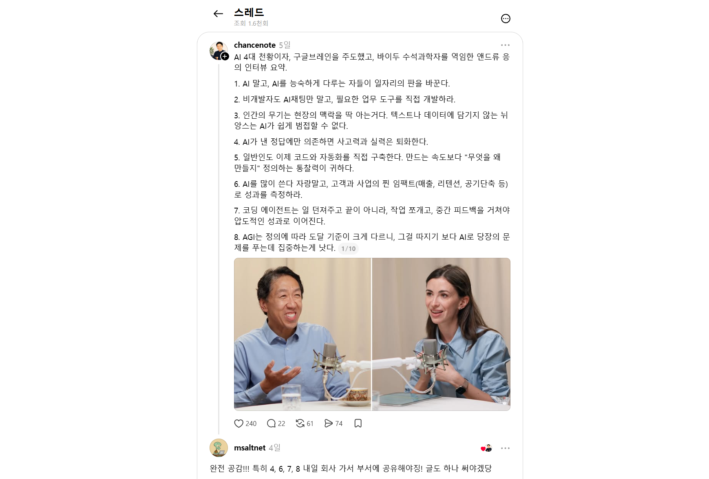

대AI시대, AI가 사람을 대신할 수 있느냐, 일자리가 줄어드느냐 마느냐를 논하는 것은 다른 사람에게 맡기고, 지금은 일단 **닥치고 확장할 때**라고 생각합니다. ~~일명 닥확~~

스레드에서 보고 무릎을 탁 친 응 형님의 인터뷰 요약글이 있었습니다. 그중 4, 6, 7, 8번을 강조해서 떠오른 이야기를 해보려고 합니다.

*chancenote가 정리한 앤드루 응 인터뷰 요약. 저는 특히 4, 6, 7, 8번에 공감했습니다.*

## 에이전트 부대가 필요하다

이유는 단순 명확합니다. 제가 생각하는 지금 AI의 가장 큰 베네핏은 **확장성**입니다.

사람이 그리던 거, 말하던 거, 노래하던 거, 코드 짜던 거 보고 배워서 흉내를 잘 내는 거죠. 그래서 내가 하던 일을 시킬 수 있습니다. 혼자서는 시간이 없어서 미뤄두었던 일도 같이 해볼 수 있고요.

인간이 못하던 일을 하게 되었다? 풀리지 않는 난제를 드디어 풀었다? 그것도 좋지만, 일단은 내가 하던 일이나 잘 시키는 게 지금 제일 명확한 🐶꿀입니다.ㅎ

그러려면 에이전트 부대가 필요합니다. 부대! Fleet! Corps! 하나에게 이것저것 다 시키는 것보다 일을 나눠서 동시에 진행! 확장 또 확장! ~~로템 11시 섬 멀티 지금이야~~

## Workflow와 Agent 그리고 나

Anthropic의 [「Building effective agents」](https://www.anthropic.com/research/building-effective-agents)에서는 Workflow와 Agent를 구분합니다. Workflow는 미리 정해진 경로에 따라 모델과 도구를 활용하고, Agent는 모델이 작업 과정과 도구 사용을 스스로 결정합니다.

많은 사람들이 자율형 Agent를 꿈꿉니다. 손 안 대고 코 푸는 거 좋아함ㅋ 저도 좋아합니다. 일이 알아서 잘 끝나면 얼마나 좋겠어요.

자율형 Agent는 사실 Workflow에 가까운 느낌인데, 결국 Workflow 보다는 Agent가 보다 능동적으로 상황 대처가 가능하니까 더 유연하고 폭넓게 사용될 수 있겠죠. 대신 그만큼 리스크도 큽니다. 즉, 예외 상황 처리에 사람이 더 많이 개입해야 할 수 있는 것이죠.

그렇게 생각해 볼 때, Agent 부대를 운영할 때 중요한 건 **필요할 때 적절한 피드백을 줄 수 있느냐**입니다. 방향이 어긋났는데 끝날 때까지 기다렸다가 처음부터 다시 시키면, 그건 손 안 대고 코 풀려다가 일이 더 커진 거잖아요.

그래서 개입을 줄이는 것만큼이나 **개입하는 비용을 낮추는 것**이 중요하다고 생각합니다. 지금 무슨 일을 하고 있는지 쉽게 볼 수 있고, 방향이 다르면 바로 알려주고, 바뀐 결과를 빠르게 확인할 수 있어야 합니다. 모든 결과를 처음부터 끝까지 살펴보는 대신 어디를 확인해야 할지도 알 수 있으면 좋겠고, 당연히 이 모든 것들은 비동기로, 어디서든 처리할 수 있으면 좋지요.

## 사고력과 실력

사고력과 실력이 무엇인지 모르겠다면 그것에 대해서 더 생각해보길 바랍니다. 더, 더, 더...ㅎ

저는 생각하고 또 생각하는 것이 사고력이고, 그것을 실행하는 것이 실력이라고 생각합니다. AI는 생각의 범위를 넓히고 실행을 도와줍니다. 다른 관점을 보여주기도 하고, 혼자라면 시도하지 못했을 일을 시작하게 해주기도 하죠.

하지만 생각할 기회까지 전부 넘기고 결과를 받아들이기만 하면, 오히려 스스로 생각하고 실행하는 힘은 쇠퇴할 수 있다고 생각합니다. AI가 만든 답을 읽고 고개를 끄덕이는 것과, 내가 왜 그 답을 선택했는지 설명할 수 있는 것은 다르니까요. **AI한테 바로 묻지 말고, 충분히 생각해본 다음 AI한테 물어보세요. 그리고 최종 결정할 때는 왜 그걸 선택했는지 스스로 결정하세요. 그게 진짜 중요해요.** 왜냐고 묻지 않고 일하는 버릇이 생기면, 어느 순간 바보가 되어요.

제가 저희 팀원한테 그거 왜 그렇게 결정했냐고 물었을때, 기술적으로 그렇게 선택한 이유가 궁금해서, 구현해서 반영한 본인도 잘 모르고 클로드가 시켜서 그렇게 했다고 하는 답을 올해 몇 번 들었는데, 정말 심각한 문제입니다. 스스로 물어 볼 수도 있고, 조언을 받을 수도 있지만 그걸 아무 생각없이 그냥 실행만 한다면...😢

엔지니어는 수 없이 많은 선택을 해야하는데,~~변수명 선택 미쳐버림~~ 저는 그 **결정의 순간이 엔지니어로서 희열과 긴장을 느끼는 포인트**라고 생각합니다. 아시겠지만, 엔지니어는 학자가 아닙니다. 현실에서 기술 선택지의 다양한 조합을, 시간과 공간, 금융까지 고려한 선택의 연속입니다. 그래서 정답이 없고, 왜 그걸 선택했는지 토론하고, 확인하고 또 변경하고 토론합니다. **그렇게 모인 결정들이 우주선이 다시 젓가락 위에 내려앉게 만듭니다.** 저는 그게 너무 재미있어서 아직도 즐겁게 일합니다. 히히

클로드가 잘 알겠죠. 근데, 제가 클로드가 결정한걸 수 없이 많이 뒤집었습니다. 모든 맥락이 다 제대로 들어가지 못해서 그렇다고 할지도 모르겠지만, 그래도 클로드는 절대 저보다 더 잘 선택할 수 없어요. 선택의 순간 제 마음은 모르잖아요.

AI로 능력을 마구 확장하세요. Agent 부대를 만들고, 토큰을 태우세요. 근데, 거기서 완전히 빠지진 마세요. 중요한 지점에서 인간으로서 그 순간을 장악하고, 즐기세요.
