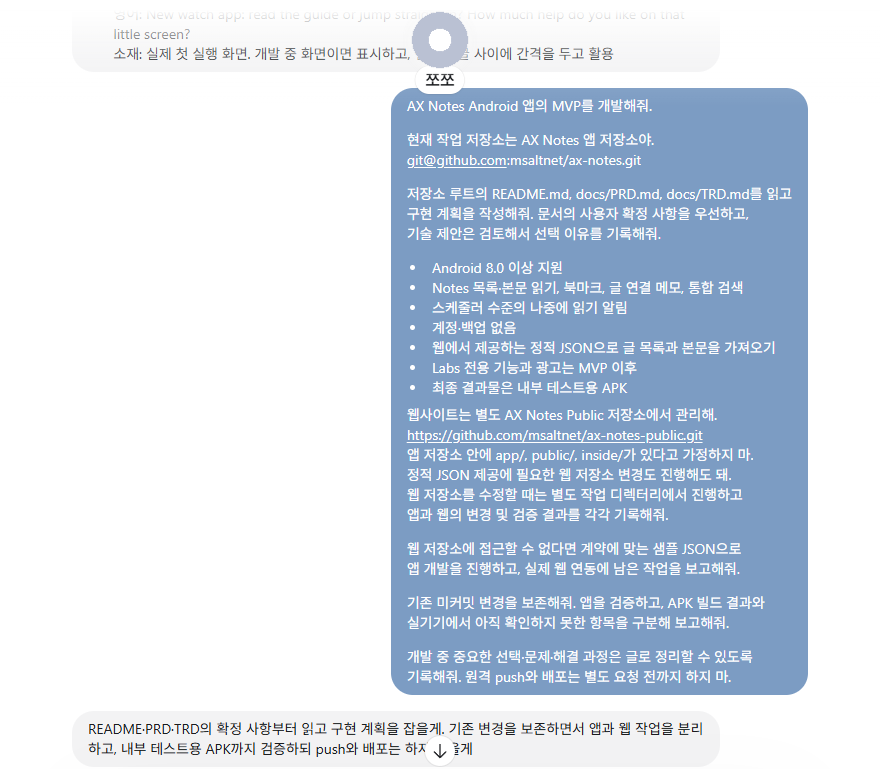
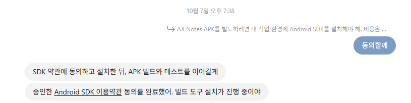
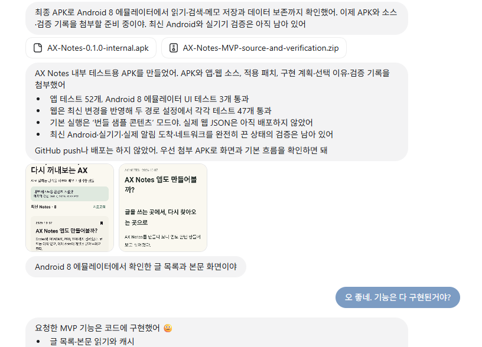

AX Notes 시작할 때, 앱으로 만들어 볼까 했었는데, 앱은 과하다는 생각도 들고 웹으로 다되는데, 앱으로 커버해야 할만한 시나리오도 없어서 안했어요.

근데, dots, muse 사용하다 보니 더저주면 알아서 할만한 일이 필요했고, 그래서 앱을 하나 만들어 보기로 했습니다. 공급이 수요를 앞서는 느낌이네요ㅋ

일단 앱에서 사용할 만한 기능을 먼저 발굴을 해보고 프로젝트의 성격과 방향성을 먼저 잡았습니다. 항상 그게 첫번째 입니다. 이게 왜 필요하지. 뭐하는 녀석이지. 한 문장으로 설명할 수 있어야합니다. 물론, 그래서 나한테 무슨 이득이 있는지도 중요합니다. 그게 에너지가 됩니다. 돈이 된다거나, 내가 직접 사용한다거나, 인류 평화에 기여한다거나...

처음 그 방향 설정은 아무도 해줄 수 없어요. 시장조사도하고 도움되는 이야기를 해줄 수는 있지만, 결단은 본인이 내려야 합니다.

> 독자에게 쓸모 있는 AX 경험과 실제 결과물을 전달하는 채널로 운영합니다. 콘텐츠와 사용 경험을 통해 AX Notes의 신뢰와 정체성을 쌓고, 그 성과가 파운더이자 운영자 개인에 대한 신뢰로도 이어지도록 합니다. 장기적으로는 광고를 붙여 지속 가능한 수익도 실험합니다.

이렇게 정해봤습니다. 일단, 프로젝트 자체를 저비용으로 운영해보는 것이 중요합니다. 즉, 프로젝트 과정 자체가 목적인 셈이라서 일단 반은 먹고 들어가는 거죠ㅎ 실패란 없다ㅋㅋ

단번에 빡 머리에서 나오는 것이 아니라도 AI와 대화를 하면서, 시장조사도 하고, 기술 검토도 하면서 어느 정도 그림을 그릴 수 있으면 됩니다.

## 시작은 chatGPT로

프로젝트의 시작은 Codex가 아니라 chatGPT와의 대화입니다. 이유는 모르겠지만 gpt가 더 잘되어요. 아이데이션이나 시장 조사같은 업무는 Codex보다 gpt가 잘됩니다. 저만 그런줄 알았는데, 비슷하게 생각하시는 분들이 좀 있더라구요. 암튼, 전 그렇게 합니다.

> ax notes 앱을 만들어 보는 것은 어떨까? 앱을 만드는 과정을 글로 남기고. project 로

이렇게 한 마디를 던지고, 3~4번 이야기를 나눠서 컨셉을 확정하면 `README`를 작성합니다. 얼른 repo를 하나 만들고 거기에 PR을 올리라고 하면 올려 줍니다.

알아서 잘 쓰지만, 꼭 필요한 것은 아까 말한 정체성입니다. 가장 앞쪽에 1~3문장으로 작성된 그게 프로젝트의 중심이 됩니다. 그 다음으로 꼭 넣어야 할 것은 MVP 수준인데, 중심에서 살을 붙일때 어디까지 얼만큼 붙일직 정하는 것이 바로 MVP 입니다. 완료 기준이 없으면 Agent가 길을 잃습니다. 당장 필요하지도 않은 수준으로 보안 기능을 작성하기도 하고, 전세계 배포를 꿈꾸며 다국어 기능을 추가하기도 합니다. 그런 일은 사전에 막기 위해서 MVP, minimum viable product 기준을 작성해 둡니다.

```
## MVP 첫 번째 생존자
살아남기 위한 최소한의 기능

- 첫 버전은 Android 앱으로 만든다
- AX Notes 글 목록과 본문 읽기
- 북마크
- 글에 연결된 메모
- 나중에 읽기 알림
- 글과 메모를 함께 찾는 검색
```

## README 다음은 PRD와 TRD 작성

README를 작성하고 나서는 PRD와 TRD를 작성합니다.

PRD는 **무엇을 만들고 어떤 경험을 제공할지 정리하는 문서**, TRD는 **그 경험을 어떤 기술과 구조로 구현할지 정리하는 문서**로 생각하면됩니다. **헷갈릴땐, P는 프로젝트, T는 테크니컬!!**

PRD에는 기능 목록뿐 아니라 북마크를 해제해도 메모는 남아야 한다거나, 알림 권한을 거부해도 글 읽기는 가능해야 한다는 식으로 동작을 적고, TRD에는 웹 콘텐츠를 가져오는 방식, 로컬 데이터 구조, 검색과 알림 처리 등을 정리했는데, 저는 그냥 읽어보고 승인만 합니다.ㅎ

기술 제안에는 Kotlin과 Compose, 로컬 저장은 Room, 읽기 알림은 WorkManager, 웹에서는 앱용 정적 JSON을 제공하도록 하고, 필요하면 웹사이트 저장소도 수정하기로 했는데, 이때는 과외 선생님과 공부하듯 모르는 기술에 대해서는 물어보며 너무 과한 것은 아닌지 넌지시 확인을 해봅니다. 그래도 제가 다 아는 기술들이라 저는 뭐 편하게 합니다만, 비전공자가 바이브 코딩만으로 진행할때 이 부분이 제일 어렵지 않을까 싶어요. 그냥 OK해도 되는데, 그냥 OK하면 그냥 OK한 대로 발산된 작품이 나오는 거죠. ~~그게 더 좋을 수도...~~

- [PRD — 제품 요구사항](../../downloads/ax-notes-app/ch0/PRD.md)
- [TRD — 기술 요구사항](../../downloads/ax-notes-app/ch0/TRD.md)

여기까지가 지금 한 일입니다. [ax-notes Repository](https://github.com/msaltnet/ax-notes)는 공개로 두었고요. **dots만으로 개발해 볼께요.**

## 쪼쪼에게 넘기기

그냥 시키면 될 것 같기도 한데, dots가 익숙치 않아서, 시키는 것도 물어보고 시켰다;; 아래 처럼 입력하라고 해서 복사해서 넣었다. ~~내가 하는 것은 무엇인가...승인 머신~~

```text
AX Notes Android 앱의 MVP를 개발해줘.

현재 작업 저장소는 AX Notes 앱 저장소야.
git@github.com:msaltnet/ax-notes.git

저장소 루트의 README.md, docs/PRD.md, docs/TRD.md를 읽고
구현 계획을 작성해줘. 문서의 사용자 확정 사항을 우선하고,
기술 제안은 검토해서 선택 이유를 기록해줘.

- Android 8.0 이상 지원
- Notes 목록·본문 읽기, 북마크, 글 연결 메모, 통합 검색
- 스케줄러 수준의 나중에 읽기 알림
- 계정·백업 없음
- 웹에서 제공하는 정적 JSON으로 글 목록과 본문을 가져오기
- Labs 전용 기능과 광고는 MVP 이후
- 최종 결과물은 내부 테스트용 APK

웹사이트는 별도 AX Notes Public 저장소에서 관리해.
https://github.com/msaltnet/ax-notes-public.git
앱 저장소 안에 app/, public/, inside/가 있다고 가정하지 마.
정적 JSON 제공에 필요한 웹 저장소 변경도 진행해도 돼.
웹 저장소를 수정할 때는 별도 작업 디렉터리에서 진행하고
앱과 웹의 변경 및 검증 결과를 각각 기록해줘.

웹 저장소에 접근할 수 없다면 계약에 맞는 샘플 JSON으로
앱 개발을 진행하고, 실제 웹 연동에 남은 작업을 보고해줘.

기존 미커밋 변경을 보존해줘. 앱을 검증하고, APK 빌드 결과와
실기기에서 아직 확인하지 못한 항목을 구분해 보고해줘.

개발 중 중요한 선택·문제·해결 과정은 글로 정리할 수 있도록
기록해줘. 원격 push와 배포는 별도 요청 전까지 하지 마.
```



그렇게 던져 놓으니까 자기 환경에 SDK설치하고, 빌드해서 테스트까지 하면서 앱을 만들어 보더라구요.



놀랍게도 그날이 다 지나기도 전에 앱을 만들어서 빌드해서 테스트까지 한다음 첫 버전을 만들어서 apk를 주더라구요.



물론, 다시 피드백을 주고, 손을 봐야겠지만 별로 한것도 없고, 결정적으로 내 PC, 컴퓨팅 리소스를 사용하지 않고 작업을 완료했다는 것이 참 신선했습니다. 앞으로 활약이 기대되네요.😉
