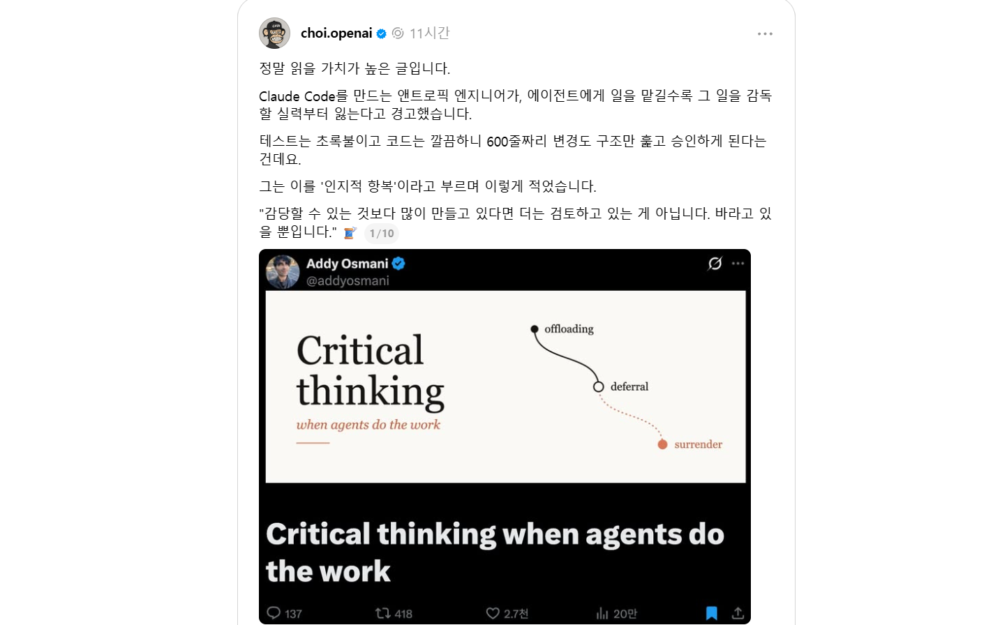

제가 팔로우하는 스레드 계정에서 인지적 항복에 관한 글을 소개해주셨습니다. Agent에게 일을 맡길수록 그 일을 감독할 실력도 잃을 수 있다는 이야기였는데, 읽으면서 마음이 참 무거웠습니다.

*제가 팔로우하는 스레드 계정에서 소개한 Addy Osmani의 글.*

소개를 따라 읽은 Addy Osmani의 [「Cognitive Surrender」](https://addyosmani.com/blog/cognitive-surrender/)는 올해 5월에 작성된 글입니다. 몇 달 전에 나온 글인데, 저는 지금 그 내용을 너무나 절절하게 느끼고 있습니다. 요즘 제가 보고 겪는 모습들이 그대로 담겨 있어서, 이 글도 함께 소개하고 싶었습니다.

최근에 꽤나 참담한 장면을 보았습니다.

문제가 생긴 시스템이 있었는데, 담당자가 내부에서 어떻게 동작하는지 잘 모르고 있었습니다. 그리고 문제를 해결하기 위해 서버에 root 권한으로 SSH를 연결해 Agent에게 디버깅을 맡겼습니다.

Agent가 로그를 보고, 원인을 찾고, 명령을 실행합니다. 사람은 그 과정을 바라보고 있습니다. 문제가 해결되면 다행이겠죠. 그런데 저는 그 장면을 보면서 이런 생각이 들었습니다.

**지금 이 시스템을 이해하고 있는 사람은 누구지? 문제가 더 커지면 누가 멈출 수 있지?**

AI에게 디버깅을 맡기는 것 자체가 문제라는 이야기는 아닙니다. 저도 Agent를 쓰고, 모르는 것을 물어보고, 직접 찾기 어려운 문제의 원인을 찾아달라고 합니다. 그런데 담당자도 내부 동작을 모르고, 어떤 명령이 어떤 결과를 낼지 판단하기 어려운 상태에서 가장 높은 권한까지 넘기는 장면은 다른 이야기로 다가왔습니다.

문제 해결을 도와달라고 한 것일까요. 아니면 문제를 이해하고 해결할 책임까지 넘겨버린 것일까요.

## 인지 항복

이런 상황을 설명하는 말이 바로 인지 항복입니다. 이름부터 좀 무섭습니다.

글에서 소개하는 개념은 Wharton의 Steven Shaw와 Gideon Nave가 제시한 것으로, AI의 답을 충분히 따져보지 않고 자신의 판단처럼 받아들이는 상황을 가리킵니다. Osmani는 일을 도구에 맡기는 것과 판단까지 넘기는 것을 구분합니다. 계산을 맡기고 결과가 말이 되는지 생각하는 것과, 결과를 그대로 받아들이며 생각을 멈추는 것은 다르다는 거죠.

처음에는 편리해서 시작합니다. 이 코드가 무슨 일을 하는지 물어보고, 변경 사항을 요약해달라고 합니다. 그러다 변경량이 점점 많아지고, 테스트는 통과하고, 설명도 그럴듯하니 대충 훑어보고 승인합니다. 어느 순간부터는 내가 이해했는지보다 Agent가 잘했을 것이라는 기대가 앞서게 됩니다.

**검토하고 있다고 생각하지만, 사실은 잘되기를 바라고 있는 것일지도 모릅니다.**

이게 남의 이야기 같지 않습니다. 저도 Agent가 만들어낸 결과가 너무 많아지면 하나하나 따라가기 어려울 때가 있습니다. 빨리 다음 일로 넘어가고 싶고, 그럴듯한 설명을 들으면 넘어가고 싶은 유혹도 있습니다. 그래서 더 무섭습니다. 인지 항복은 어느 날 갑자기 선언하는 것이 아니라, 편리한 순간들이 쌓이면서 찾아올 수 있으니까요.

## 딸깍의 시대

바이브 코딩은 정말 놀랍습니다. 만들고 싶은 것을 말하면 앱이 나옵니다. 예전에는 시작조차 하지 못했을 사람들이 자신의 아이디어를 실행해볼 수 있게 되었습니다. 저 역시 이 확장성이 좋고, 앞으로도 적극적으로 사용할 생각입니다.

그런데 이제는 앱을 만드는 것에서 끝나지 않습니다. Agent가 기능을 만들고, 테스트하고, 스크린샷을 만들고, 주요 기능을 소개하는 문구를 씁니다. 심사를 준비하고 검토하는 일까지 Agent에게 맡길 수 있습니다. 그렇게 딸깍, 딸까딱 만들어진 앱이 계속 쏟아져 나옵니다.

앱스토어의 공식 심사가 모두 자동화되었다는 뜻은 아닙니다. 제가 걱정하는 것은 출시를 준비하는 쪽에서 제품을 확인하고 심사에 대응하는 과정까지 생각 없이 넘겨버릴 수 있다는 점입니다.

그 과정에서 사람은 무엇을 알게 되었을까요?

이 앱이 누구의 어떤 불편을 해결하는지, 왜 이 기능이 중요한지, 사용자가 데이터를 잃으면 어떻게 되는지. 스크린샷에 적힌 설명이 실제 경험과 일치하는지. 문제가 생겼을 때 어디서부터 살펴봐야 하는지요.

만든 사람조차 답하지 못하는 앱이 출시될 수 있습니다. 기능은 돌아가고, 소개 문구는 매끄럽고, 스크린샷은 번듯합니다. 하지만 그 제품에서 무엇이 중요한지 아는 사람이 없다면, 우리는 대체 무엇을 출시한 걸까요.

모든 앱의 모든 코드를 사람이 한 줄씩 이해해야 한다고 생각하지는 않습니다. 원래도 개발자는 수많은 라이브러리와 서비스를 이해의 추상화 위에서 사용해왔으니까요. 하지만 적어도 **사용자에게 어떤 약속을 했고, 어디서 문제가 생길 수 있으며, 문제가 생겼을 때 누가 어떻게 대응할 것인지**는 알아야 하지 않을까요.

## 편해지는 만큼 실력도 자랄까

걱정은 지금 모른다는 사실에서 끝나지 않습니다. 계속 모르는 채로 넘어가면, 앞으로 알게 될 기회도 줄어듭니다.

문제가 생겼을 때 원인을 추측하고, 틀려보고, 로그를 따라가고, 다시 고치는 과정은 고통스럽습니다. ~~특히 금요일 저녁에는 더요.~~ 그런데 그 과정에서 시스템을 배우고 다음 문제를 해결할 힘도 생깁니다. 에러 메시지를 그대로 Agent에게 던지고 해결되었다는 보고만 받는다면, 문제는 없어져도 경험이 내 것이 되지는 않을 수 있습니다.

[Anthropic의 연구](https://www.anthropic.com/research/AI-assistance-coding-skills)는 새로운 Python 라이브러리를 배우는 개발자들을 대상으로 AI 사용과 학습을 살펴봤습니다. 연구에서는 AI를 사용한 집단의 이해도 평가 점수가 평균적으로 더 낮았고, 특히 디버깅에서 차이가 두드러졌습니다. 반면 AI에게 설명을 구하고 자신의 이해를 확인하는 등 적극적으로 생각하며 사용한 참가자들은 학습 성과를 유지하기도 했습니다.

물론 하나의 짧은 실험으로 모든 개발자의 장기적인 능력이 쇠퇴한다고 단정할 수는 없습니다. 그래도 질문은 남습니다. **일을 끝내는 동안 나는 무엇을 배웠는가.**

Agent가 더 유능해질수록 사람의 이해가 덜 필요해 보일 수 있습니다. 그런데 Agent의 결과를 살펴보고 잘못된 방향을 알아차리는 데에도 이해가 필요합니다. 일을 맡길수록 감독할 실력이 필요한데, 일을 전부 맡기면 그 실력을 기를 기회가 줄어드는 겁니다.

## 인간은 무엇을 하고 있는가

이전에 AI는 확장성이라는 생각을 글로 정리한 적이 있습니다. 지금도 같은 생각입니다. Agent를 사용하면 혼자서는 엄두도 내지 못했던 일에 도전할 수 있습니다. 더 많은 일을 시도하고, 더 넓은 선택지를 살펴볼 수 있습니다.

다만 확장되는 것이 결과물의 양뿐이라면, 그건 누구의 확장일까요. 내가 생각하고 결정할 수 있는 범위도 넓어졌을까요. 아니면 내가 이해하지 못하는 결과물만 빠르게 쌓이고 있을까요.

저는 인간의 역할이 그저 마지막 승인 버튼을 누르는 것은 아니라고 생각합니다. 무엇을 왜 만드는지 정하고, 누구에게 어떤 영향을 줄지 살피고, 충분하지 않으면 멈추는 것. 결과가 기대와 다를 때 확인할 수 있도록 이해를 쌓고, 판단의 이유를 설명하는 것. 그리고 잘못되었을 때 사용자 앞에 서는 것까지요.

이를 위해 모든 일을 직접 할 필요는 없습니다. 다만 중요한 부분에서는 시간을 들여 물어봐야 합니다. 왜 이런 구조를 선택했는지, 다른 방법은 없는지, 실패하면 어떤 일이 생기는지. Agent에게 설명과 반론을 요구하고, 직접 사용해보고, 이해하지 못한 채 넘어가는 부분을 알아야 합니다. 서버를 고칠 때라면 어떤 권한이 정말 필요한지, 실행할 명령을 어떻게 확인하고 되돌릴 수 있는지도요.

물론 이해하려면 시간이 듭니다. 딸깍 한 번이면 끝날 일을 붙잡고 있는 것처럼 보일 수도 있습니다. 하지만 그 시간은 생산성을 방해하는 낭비가 아니라, 다음에도 우리가 판단할 수 있도록 실력을 남겨두는 시간이라고 생각합니다.

사람의 개입이 줄어드는 것이 반드시 나쁜 일은 아닙니다. 반복 작업에서 벗어나 더 중요한 문제를 고민할 수도 있으니까요. 그런데 줄어든 개입과 함께 궁금함도, 이해하려는 노력도, 책임감도 사라진다면요.

그때는 인지 항복을 넘어 **인간 항복**이라고 불러야 하지 않을까요.

Agent는 오늘도 무언가를 만들고 있습니다. 그 옆에서 우리는 무엇을 하고 있을까요.

---

## 함께 읽어보세요: 인지적 위임과 인지적 포기

제가 이야기한 고민을 더 깊이 생각해보고 싶다면 아래 글도 한 번 읽어보세요. 코드 리뷰와 디버깅에서 인지적 포기가 어떻게 나타나는지, 그것을 막기 위해 어떤 습관과 작업 방식을 만들 수 있는지 구체적으로 짚어줍니다.

아래는 Addy Osmani의 [「Cognitive Surrender」](https://addyosmani.com/blog/cognitive-surrender/)를 바탕으로 정리한 한국어 번역·요약문입니다. 원문의 주장과 저자의 관점을 담고 있으며, 이해를 돕기 위해 소제목을 나누고 일부 내용을 요약했습니다. 정확한 표현과 전체 맥락은 원문을 참고해주세요.

> **인지적 위임(Cognitive Offloading)**은 AI에 작업을 맡기면서도 결과에 대한 판단과 책임은 자신이 유지하는 것이다. **인지적 포기(Cognitive Surrender)**는 AI의 결과가 어느새 자신의 결과가 되어, 더는 검토할 필요조차 느끼지 못하는 상태다.

소프트웨어 엔지니어에게 이 둘의 경계는 거의 매일 달라진다. 우리 대부분은 그 경계를 넘고 있다는 사실조차 알아차리지 못한다.

---

## 1. 인지적 위임과 인지적 포기

펜실베이니아대학교 와튼스쿨의 Steven Shaw와 Gideon Nave는 [Thinking – Fast, Slow, and Artificial](https://papers.ssrn.com/sol3/papers.cfm?abstract_id=6097646)에서 두 개념을 구분한다.

- **인지적 위임(Cognitive Offloading)**: 계산기, 검색엔진, GPS처럼 작업의 수행 방법을 도구에 맡기되 무엇을 할지와 결과의 타당성은 스스로 판단한다.
- **인지적 포기(Cognitive Surrender)**: 독립적인 판단 자체를 형성하지 않고 AI의 답을 자신의 답으로 받아들인다.

1,372명이 참여한 세 가지 실험에서 AI가 틀린 답을 제시했을 때도 참가자들은 **73%의 경우 오답을 받아들였다.**

더 놀라운 점은 답변의 절반이 의도적으로 잘못되었음에도 AI를 사용할 때 참가자들의 확신이 높아졌다는 것이다.

사람들은 모델의 자신감을 빌려 자신의 확신처럼 받아들이고 있었다.

## 2. 개발 업무에서 인지적 포기가 나타나는 순간

### 코드 리뷰

에이전트가 600줄짜리 PR을 생성한다.

변수 이름은 적절하고 테스트도 통과했다. 코드를 훑어본 뒤 승인한다.

하지만 중간 어딘가에는 트랜잭션 실행 순서의 미묘한 변경이나 예상하지 못한 예외 상황의 문제가 숨어 있다.

당신은 코드를 리뷰한 것이 아니라 단순히 승인한 것이다.

**인지적 포기의 핵심은 잘못된 판단이 아니라 판단 자체가 없었다는 데 있다.**

### 디버깅

복잡한 스택 트레이스를 에이전트에게 전달한다. 수정안을 받아 적용하니 문제가 해결된다.

하지만 2주 후 비슷한 문제가 다시 발생한다.

그제야 원래 버그를 이해한 적이 없다는 사실을 깨닫는다.

문제의 원인을 해결한 것이 아니라 눈에 보이는 증상만 제거했던 것이다.

### 설계 결정

서비스 사이에 큐를 사용할지 직접 호출할지 고민한다.

에이전트는 그럴듯한 설명과 함께 하나를 추천한다.

하지만 처리량, 장애 방식, 재처리 의미론을 직접 검토하지 않은 채 그대로 따른다.

문제의 정의부터 해결책까지 모델의 판단을 받아들인 것이다.

### 새로운 기술 학습

[Anthropic의 코딩 역량 형성 연구](https://www.anthropic.com/research/AI-assistance-coding-skills)에 따르면 새로운 라이브러리를 학습하면서 AI로 코드를 생성한 엔지니어들은 이후 이해도 평가에서 대조군보다 17% 낮은 점수를 받았다.

반면 AI를 개념 탐구와 질문에 활용한 사람들은 이해도 수준을 유지했다.

같은 도구라도 활용 방식에 따라 결과가 달라졌다.

---

## 3. 이해 부채(Comprehension Debt)

[이해 부채](https://addyosmani.com/blog/comprehension-debt/)란 시스템에 존재하는 코드의 양과 사람이 실제로 이해하는 코드의 양 사이의 격차다.

인지적 포기는 이해 부채가 쌓이는 메커니즘이다.

- 완전히 이해하지 못한 패치가 추가된다.
- 직접 내리지 않은 설계 결정이 누적된다.
- 스스로 명세하지 않은 테스트가 추가된다.

당장은 문제가 없어 보이지만 시간이 지나면서 누적된다.

MIT의 [Your Brain on ChatGPT](https://www.media.mit.edu/publications/your-brain-on-chatgpt/) 연구에서도 AI에 의존해 글을 작성한 사람들이 신경 연결성, 기억력, 자신의 추론을 재구성하는 능력에서 약화된 모습을 보였다.

연구진은 이를 **인지 부채(Cognitive Debt)**라고 불렀다.

**인지적 포기는 인지 부채를 떠안는 행동이다. 이해 부채는 잃어버린 정신적 모델에 대한 청구서다.**

그 이자는 다음번에 문제가 발생했을 때 지불하게 된다.

AI 자체가 부채를 만드는 것은 아니다. AI를 사용하는 태도가 부채를 만든다.

## 4. 소프트웨어 엔지니어가 특히 취약한 이유

### 표면적인 정확성

AI가 생성한 코드는 컴파일되고, 린터를 통과하고, 실행되며, 기존 코드와 비슷해 보인다.

하지만 **표면적인 정확성이 시스템 전체의 정확성을 보장하지는 않는다.**

### 생산량 중심의 성과 지표

머지된 PR, 출시한 기능, 종료한 티켓 수는 다음 두 상황을 구분하지 못한다.

- 내가 직접 만들었고 이해하고 있다.
- 에이전트가 만들었고 나는 승인만 했다.

조직은 단기적으로 두 결과를 동일하게 평가한다.

### 확신의 전이

모델은 단정적인 표현을 사용한다.

예를 들어 "화면 끊김을 방지하기 위해 300ms 디바운스를 사용합니다"라는 설명은 기술적 근거가 있는 것처럼 들린다.

하지만 그 숫자는 모델이 즉석에서 만들어낸 것일 수도 있다.

### 누적되는 의존성

한 번 이해하지 못한 코드를 받아들이면 다음 수정에서도 판단을 포기하기 쉬워진다.

독립적인 판단을 하려면 이전에 생략한 이해 과정부터 복구해야 하기 때문이다.

---

## 5. 판단을 보정하는 질문

Shaw는 인지적 포기가 AI 사용 자체를 부정하는 개념은 아니라고 강조한다.

> 핵심은 AI가 자신의 사고를 돕고 있는 순간과 자신도 모르게 사고 자체를 대신하고 있는 순간을 구분하는 것이다.

스스로에게 계속 질문해야 한다.

**나는 이 답에 대해 독립적인 판단을 형성하고 있는가? 아니면 에이전트의 판단을 그대로 받아들이고 있는가?**

이를 위한 실천 방법은 다음과 같다.

### 결과를 보기 전에 예상 결과를 생각한다

에이전트에게 중요한 작업을 맡기기 전에 결과가 어떤 모습이어야 할지 예상한다.

예상과 다른 결과가 나오면 스스로 판단해야 한다.

내가 틀렸는가, 에이전트가 틀렸는가?

### AI가 작성하지 않은 코드처럼 리뷰한다

팀의 주니어 엔지니어가 제출한 PR이라고 가정하자.

테스트가 통과한다는 이유만으로 머지하지는 않을 것이다.

AI가 작성한 코드에도 같은 기준을 적용해야 한다.

**"맞는 것 같다"는 것은 코드 리뷰가 아니다.**

### 모델에게 반론을 요청한다

모델이 제시한 답에 대해 반대 논리를 만들어보라고 요청한다.

두 주장 중 어느 것이 옳은지 스스로 판단할 수 없다면 인지적 포기의 위험을 발견한 것이다.

### 피로한 상태를 인식한다

하루의 첫 PR은 꼼꼼하게 리뷰하지만 다섯 번째 PR은 대충 훑어보게 된다.

결과를 제대로 평가할 수 없을 만큼 피곤하다면 에이전트에게 더 많은 코드를 생성시키지 않는 편이 낫다.

### 확신의 출처를 확인한다

설계 결정을 설명할 때 왜 그런 결정을 내렸는지 재구성할 수 있어야 한다.

에이전트가 제안했고 그럴듯해 보였다는 것만 기억난다면 모델의 확신만 물려받은 것이다.

---

## 6. 인지적 포기를 방지하는 엔지니어링 실천

### 검증을 필수 완료 조건으로 설정한다

에이전트가 완료한 모든 작업에는 구체적인 증거가 있어야 한다.

테스트, 스크린샷, 로그, 런타임 트레이스, 리뷰어 승인 등이 그 예다.

"완료된 것처럼 보인다"가 아니라 **"정상 동작한다는 증거가 있다"**를 완료 조건으로 삼아야 한다.

### 합리화 방지 표(Anti-rationalization Tables)

[Agent Skills](https://github.com/addyosmani/agent-skills)는 워크플로 단계를 생략하려는 흔한 핑계마다 반박을 미리 작성해 둔다.

예를 들어 다음과 같다.

- 핑계: "이 작업은 너무 단순해서 명세가 필요하지 않습니다."
- 반박: "단순한 작업에도 인수 기준은 적용됩니다."

모델이나 피곤한 개발자가 엄격한 단계를 생략할 이유를 만들어내기 전에 이를 차단하는 것이다.

### 작은 PR 유지

인지적 포기의 위험은 변경 규모에 비례한다.

50줄의 변경은 충분히 읽고 이해할 수 있지만 600줄은 그렇지 못할 수 있다.

Google의 약 100줄 규모 PR 관행도 이러한 관점에서 의미가 있다.

**리뷰의 단위가 이해의 단위다. 실제로 이해할 수 있을 만큼 작게 만들어라.**

### 학습할 때는 생성보다 개념 탐구를 우선한다

새로운 라이브러리나 시스템을 배울 때는 코드를 생성하기 전에 설명을 요청한다.

AI를 결과 생산보다 질문과 탐구에 활용하면 정신적 모델을 강화할 수 있다.

### 의도적인 마찰(Friction by Design)

인지적 포기를 방지하기 위해 의도적인 확인 단계를 도입한다.

- 코드 생성 전 설계 문서
- 머지 전 확인 절차
- 배포 전 체크리스트

생산성 관점에서 마찰은 부정적으로 보이지만 인지적 위임과 포기를 구분하는 중요한 장치다.

### 매주 혼자 코드를 작성하는 시간

에이전트 없이 직접 코드를 작성하는 시간을 갖는다.

도덕적인 훈련이 아니라 자신의 역량을 점검하는 훈련이다.

AI 도움 없이 간단한 기능조차 구현하기 어려워진다면 어느새 위임이 포기로 바뀌었을 가능성이 있다.

---

## 7. 단순한 위임이 아니라 상호 증폭(Mutual Amplification)

철학자 Andy Clark는 AI에 작업을 위임하는 것과 AI와 협력하는 것을 구분한다.

단순한 위임은 인지적 포기로 이어질 수 있다.

반면 협력은 **상호 증폭(Mutual Amplification)**을 만들어낸다.

사용자의 질문이 모델의 결과를 개선하고, 개선된 결과가 다음 질문을 더 정교하게 만들며, 그 과정에서 사용자의 문제 이해도 함께 깊어진다.

상호 증폭이 이루어질 때는 대화를 통해 새로운 영역을 배우게 된다.

작업을 시작할 때보다 끝났을 때 시스템에 대한 정신적 모델이 더 명확해진다.

필요하다면 여전히 직접 구현할 수 있지만 더 빠른 경로를 선택한 것이다.

**에이전트는 방 안의 유일한 엔지니어가 아니라 함께 일하는 두 번째 엔지니어다.**

반대로 인지적 포기 상태에서는 에이전트가 사용자보다 문제를 더 잘 이해하게 된다.

사용자는 설계를 재구성하지 못하고 에이전트의 도움 없이 코드를 디버깅하지 못한다.

자신의 역량을 성장시켜야 할 업무 자체를 외부에 맡긴 것이다.

두 방식 모두 같은 도구를 사용하고 실제로 출시되는 코드를 생산한다.

한 번의 스프린트만 보면 차이가 없다.

차이는 6개월 뒤 문제가 발생했을 때 드러난다.

한 사람은 기본 원리부터 문제를 해결할 수 있지만 다른 사람은 그렇지 못하다.

---

## 8. 이 글을 통해 전하고 싶은 것

이 글의 목적은 AI 도구를 두려워하게 만드는 것이 아니다.

나 역시 매일 AI를 사용한다.

지난 12개월 동안 이전 어느 12개월보다 많은 결과물을 출시했다.

오히려 AI를 전혀 사용하지 않는 사람들이 AI를 적극적으로 활용하는 사람들보다 더 큰 실수를 하고 있다고 생각한다.

하지만 AI를 사용하는 태도가 중요하다.

지금까지의 논의는 대부분 모델이 무엇을 할 수 있는지에 집중되어 있다.

앞으로는 우리가 모델을 어떻게 사용하고 있는지에도 그만큼 관심을 가져야 한다.

AI와 함께 생각하고 있는가?

아니면 아예 생각하지 않고 있는가?

**인지적 위임은 강력한 능력이다. 인지적 포기는 그 경계를 인식하지 못할 때 발생하는 실패 방식이다.**

앞으로 엔지니어의 중요한 역할 중 하나는 자신이 그 경계의 어느 쪽에 있는지 지속적으로 판단하는 것이다.

코드는 계속 출시되는데 시스템에 대한 이해가 줄어든다면 인지 부채를 지불하고 있는 것이다.

반대로 코드를 출시하면서 시스템에 대한 이해도 깊어진다면 실제로 엔지니어의 일을 수행하고 있는 것이다. 단지 이전보다 더 빠르게 일할 뿐이다.

두 경우 모두 사용하는 도구는 같다.

**차이는 도구가 아니라 그것을 대하는 태도에 있다. 그리고 그 태도만큼은 여전히 온전히 자신의 몫이다.**
