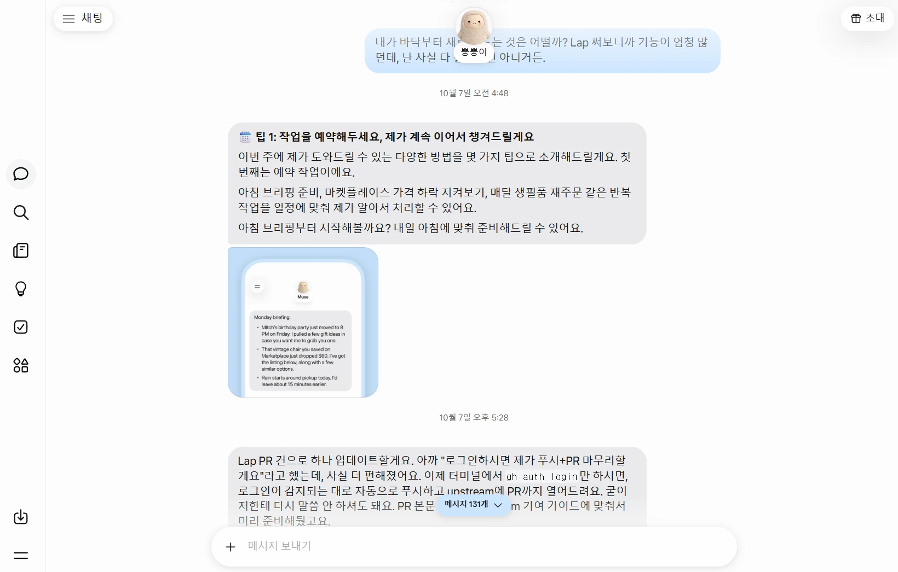
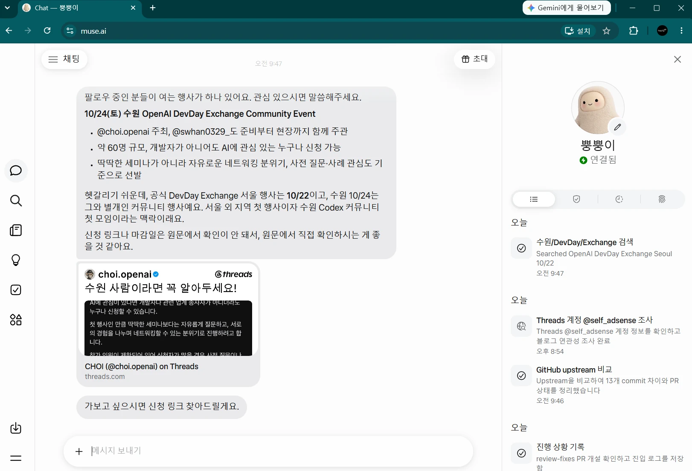

지난 글에서 쪼쪼와 뿡뿡이를 만난 이야기를 했는데요. 이번에는 무슨 일을 시켰는지 적어보려고 합니다. 무료라고 하니까 일단 이것저것 던져봤습니다. ~~양잿물 정신!~~

결론부터 말하면 쪼쪼에게는 계속 일을 시키고 있고, 뿡뿡이는 쓰다가 접었습니다. 이름까지 지어줬는데...😢

## 쪼쪼에게 시킨 일들

6가지를 시켰는데, 더 시켜도 될 것 같아요. 조금 느려서 그러지 대체로 잘 합니다.

1. **smtm 개발·개선** — 기존 프로젝트 개선
2. **AX Notes 앱·웹 개발** — README, PRD, TRD 바탕으로 바닥부터 개발, 테스트, 배포
3. **프로젝트 진행 보고** — 하루 두 번, 작업 상황을 GitHub Issue로 남기는 일
4. **고객 문의 확인·번역** — 두 시간마다 메일을 확인하고 정리
5. **Threads 운영 지원** — 게시물 아이디어와 한글·영어 초안, 댓글 번역을 준비
6. **경제 뉴스 브리핑** — 하루 세 번, 국내외 뉴스와 정책·지표를 출처와 함께 제공

개발은 기존에 만들던 자동매매 프로그램 [smtm](https://smtm.msalt.net)을 개선하도록 했습니다. 기능은 거의다 구현된 상태인데, 개선할 점을 스스로 찾아서 고치고 PR을 만들라고 했어요. 제가 승인한 PR은 병합하고 다음 작업도 이어가도록 했습니다.

**AX Notes 앱과 웹**도 맡겼습니다. 이건 [앱을 만들어보기로 한 글](../ax-notes-app-requirements-first/)에서 이야기했는데요. 실제 글을 가져오고, 태블릿에서도 잘 나오게 하고, 메모랑 북마크, 알림도 붙이는 일입니다. 웹과 앱의 폰트나 아이콘도 맞추고요. 이슈나 PR에 피드백을 남기면 수정해서 테스트 APK를 주도록 했습니다.

그냥 개발만 시켜놓으면 뭐 하고 있는지 모르니까 **진행 보고**도 시켰습니다. 매일 아침 8시, 저녁 8시에 프로젝트별로 GitHub Issue를 하나씩 남기도록 했어요. AX Notes는 앱과 웹 작업을 앱 저장소에서 한꺼번에 보고 받기로 했습니다. 여러개를 시키다보니 결국 정리하고 다시 피드백 주는게 일이더라구요. 일단은 깃헙을 최대한 활용했습니다. 슬랙이나 노션을 연결할 수도 있는데, 시스템 하나 추가하는게 빡세더라구요. ~~창하나 더 띄우는 것도 버겁고...~~

개발 말고도 시킬 일이 있더라구요. **고객 문의 메일**을 확인하고 한국어로 번역하도록 했습니다. 아침 8시부터 밤 12시까지 두 시간마다 새 문의, 후속 답장, 반송 메일까지 확인하는 일입니다.

**Threads 게시물 아이디어**도 받습니다. 요즘 마케팅은 또 Threads 잖아요? ~~AX notes도 시작해야 하는데...~~ 아침 9시, 저녁 9시에 다섯 개 정도씩, 한글과 영어 초안을 같이 달라고 했어요. 사진이나 영상은 뭘 쓰면 좋을지도 제안하고, 기존 게시물과 반응을 참고해서 중복은 줄이도록 했습니다. 댓글이나 게시글 번역도 그때그때 부탁하고요.

마지막으로 **경제 뉴스 브리핑**입니다. 아침 7시, 오후 2시, 저녁 8시에 국내, 해외, 정책과 지표로 나눠서 출처와 함께 정리하도록 했습니다.

## 이제 승인이 병목입니다

이 글을 쓰려고 진행 상황을 정리받았을 때는 [SMTM PR #89](https://github.com/msaltnet/smtm/pull/89)가 구현과 테스트를 마치고 병합을 기다리고 있었습니다. [AX Notes PR #8](https://github.com/msaltnet/ax-notes/pull/8)은 최신 피드백까지 반영하고 테스트 172개랑 에뮬레이터 검증을 끝냈다고 하더라구요. 실제 기기에서 확인하고 병합하는 일은 남아 있었고요.

테스트를 많이 했다고 제가 볼 게 없어지는 것은 아닙니다. 앱은 직접 써봐야 하고, PR도 확인해야 하고, 고객에게 보내는 답장도 읽어봐야 합니다. 해보니까 승인도 급을 나눠서 일을 줄여야겠다는 생각이 들었어요.

제가 개입하는 부분이 시작할 때, 의견을 제공하는 것과 마무리할 때 최종 확인하는 것인데, 그 횟수와 빈도를 줄이려고 계속 노려하고 있어요.🤔

## muse는 쓰다가 접었습니다

뿡뿡이에게도 비슷하게 개발을 맡겨보려고 했는데, GitHub 커넥터 연결부터 잘 안됐습니다. 일을 시키려면 저장소를 봐야 하는데 거기서부터 막히니 좀 답답하더라구요.

응답도 오래 걸릴 때가 있었는데, **20시간 뒤에 답이 온 적도 있습니다.** 20분 아니고 20시간!

저는 결과를 보고, 이거 좀 고쳐줘 하고, 다시 받아서 확인하는 식으로 개발을 하는데요. 답이 언제 올지 모르니까 이어서 하기가 어렵습니다. 무료라고 시작했지만 기다리는 제 시간까지 무료는 아니잖아요. 그래서 muse는 일단 접었습니다.

쓰면서 느낀 건데, muse는 개발보다는 일정 관리나 예약 같은 일에 더 맞는 것 같아요. 작업을 예약해두면 챙겨주겠다고 하고, 아침 브리핑도 제안하고, 관심 있을 만한 행사도 찾아서 알려줍니다. 뉴스보니까 사고 싶은 물건을 기능 및 가성비 비교 이런것도 잘 해준다고 하는데, 일단 github으로 작업하는게 빡시니까 손이 안가네요. 일단 제가 미국 외부에서 우회 접속하는 것이라 쇼핑같은 것은 더더욱이 쓸일이 없어서요. **muse 앱은 VPN을 사용해야 해서, 못쓰고 있어요;;**

어째든, 당분간은 쪼쪼에게 계속 일을 시켜보려고 합니다. 쪼쪼가 얼마나 잘했는지 어떻게 개선했는지 결과물을 가지고 다시 오겠습니다. 쪼쪼야 잘 부탁한다 😎 여기 마케팅도 추가로 시켜야지!
