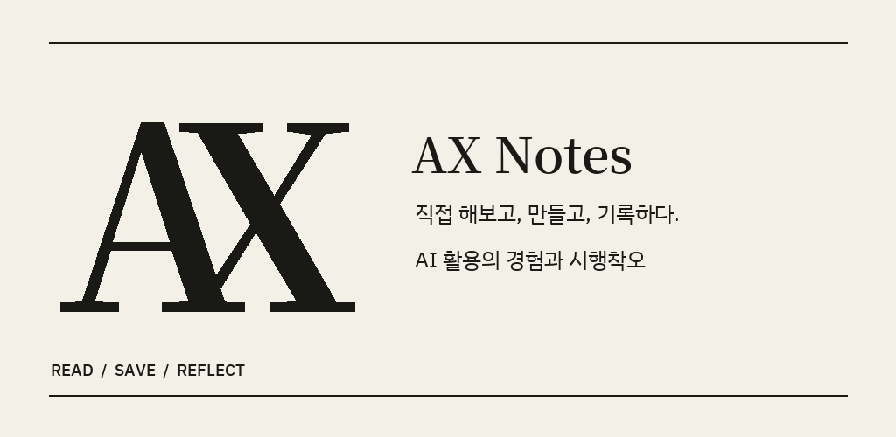
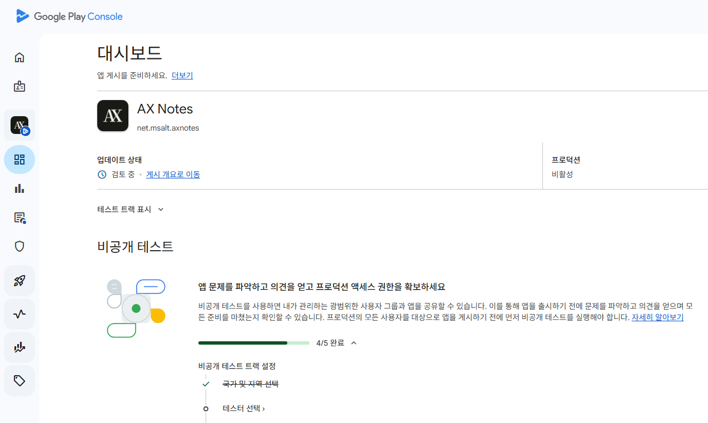

[지난 글](../dots-and-muse-delegated-tasks/)에서 쪼쪼에게 AX Notes 앱 개발을 맡겼다고 했는데요. 후후..그 앱이 Google Play에 등록하고 비공개 테스트를 준비하는 단계까지 왔습니다. 별로 한 것도 없는데. ~~별로 기능도 없음~~

익히 들어서 알고 있는, 12명의 베타 테스터를 모집하는 단계에 이르렀습니다. 막상하려니 이거 참 난감하네요. 파트원들에게 말하면 부담느낄것 같고, 보증인 찾는 것도 아니고 이거 뭐...ㅎ 우선, 자력갱생해보겠습니다. 익명의 친구분들을 모집해보는 것부터ㅎ

## 쪼쪼가 만든 AX Notes

AX Notes는 이 사이트의 **글을 읽고, 북마크하고, 글에 연결된 메모를 남기는 앱**입니다. 나중에 읽기 알림과 검색도 넣었습니다. 회원가입 없이 쓰고, 개인 메모와 북마크는 기기에 저장하는 것으로 해봤습니다.

솔직히 필요해서 만들었다기보다 쪼쪼한테 2가지 개발 프로젝트를 시켜보려고 했는데, **하나는 바닥부터 완성**이고 **다른 하나는 이미 완성된 프로젝트에 참여해서 개선**하는 것이었습니다. AX Notes는 깃헙 repository만 생성해주고 작업을 모두 쪼쪼의 컴퓨터에서 진행했습니다.

기획도 대화로 했고, 쪼쪼가 구현하고 빌드까지 해서 **GitHub 릴리스에 테스트 APK를 올려주면**, 저는 그걸 다운로드 받아서 설치하고 써봤습니다. 글을 실제로 가져오는지, 메모와 북마크가 잘 남는지, 화면은 괜찮은지 확인하고 피드백을 줬어요.

그러면 쪼쪼가 다시 수정해서 APK를 올려주고, 저는 또 받아서 확인했습니다. 이렇게 **테스트하고 피드백하고 수정하는 과정을 세 번 정도 거쳐서 앱이 완성**된 것 같아요. 제가 직접 빌드할 필요 없이 받아서 써보고 이야기하면 되니까 편하기도하고 리소스도 신경안써도 되니까 출퇴근 할 때 지하철에서 한 번 써보고 피드백 주는 방식으로 개발을 완료했습니다. 너무 간단한 앱이라 가능했지, 속 터질 수도 있는데, 반대로 **간단한 앱 개발은 이제 그냥 컴퓨터 없이도, Android Studio 설치하고 개발환경 셋업 없이도 되네요.**

## 등록과 배포도 쪼쪼와 함께

등록하고 배포하는게 어렵고 귀찮을 것 같았는데, 계정 만들고, API key 등록 및 권한 부여만 하면 이제 Codex가 다합니다. 사실 이것도 쪼쪼로 했어야 했는데, 계정이나 Key 관리는 못 시키겠더라구요...~~아직 살아있는 꼰대 마인ㄷ...~~

제가 추가로 서명키 정도만 직접 만들었고, 나머지는 **대부분 Codex가 등록을 진행해줬습니다.** 스토어 설명, 스크린샷, AAB 파일도 준비해서 올리고, 무엇보다 개인정보 처리 방침 페이지도 만들어서 올리고 URL 등록, 사용 연령 설문까지 대신 해줬어요! ~~나보다 더 잘알거야...~~

*Play Store 등록에 사용한 AX Notes 배너입니다. 이것도 Codex가 만들었는데 어떻게 만들었는지도 모릅니다ㅋ*

등록할 때 입력해야 하는 것이 엄청 많은데, 저는 브라우저도 제대로 열어보지 않고 끝냈습니다. 허허...세상 좋아졌네요.

## 편하긴 하다만...

일을 맡겨두고 나중에 결과를 받아보는 것은 여전히 신기합니다. 심지어 빌드까지! 그렇다고 제가 **할 일이 없어지는 건 아니더라구요.** 직접 앱을 써보고, 원하는 동작인지 확인하고, 등록할 내용을 결정하는 일은 남았습니다.

이렇게 만들어진 앱이 홍수처럼 쏟아져 나오고 있다는 것을 저도 잘 알고 있습니다. Threads에서 많이 보고 있습니다. 참신한 아이디어에 감탄하기도 하지만, 예전에 한 번쯤 해봤다가 부질없는 몸짓이 될 것 같아 노트 한켠에 남겨진 아이디어들이 앱으로 나오는 것도 많이 봤습니다.

**좋은 일인지, 나쁜 일인지는 모르겠습니다만, 현실입니다. 앱을 만들고, 생각했던 서비스를 만드는 일의 비용이 많이 낮아졌습니다.** 일단 저도 그래서 한 번 해봤는데, 해본 김에 몇개 더 쏟아내볼께요ㅋㅋㅋ 남은 2026년 5개 정도만 만들어 볼께요.

## 베타 테스터를 모집합니다

저 처럼 딸깍 만들어서 등록하는 사람들이 Play Store 혼잡하게 만드는 것을 막기위해서, Play Console에는 **12명 이상이 참여를 선택한 상태로 14일 이상 비공개 테스트를 진행**해야 한다고 해요. 모집합니다. 12명 이상 모이면 더 좋겠네요. ~~이 글을 12명이 읽을지 의문...~~

**참여하실 분은 [msalt.net.help@gmail.com](mailto:msalt.net.help@gmail.com?subject=AX%20Notes%20%EB%B2%A0%ED%83%80%20%ED%85%8C%EC%8A%A4%ED%8A%B8%20%EC%B0%B8%EC%97%AC)으로 메일을 보내주세요.** 제목은 `AX Notes 베타 테스트 참여` 정도면 됩니다. Google Play에서 사용할 Google 계정 이메일을 알려주시면 테스터 등록과 참여 방법을 안내드리겠습니다.

쪼쪼가 만든 앱이 다른 분들 손에서도 잘 돌아갈지 궁금하네요. 같이 써보실 분을 기다리겠습니다 😎
