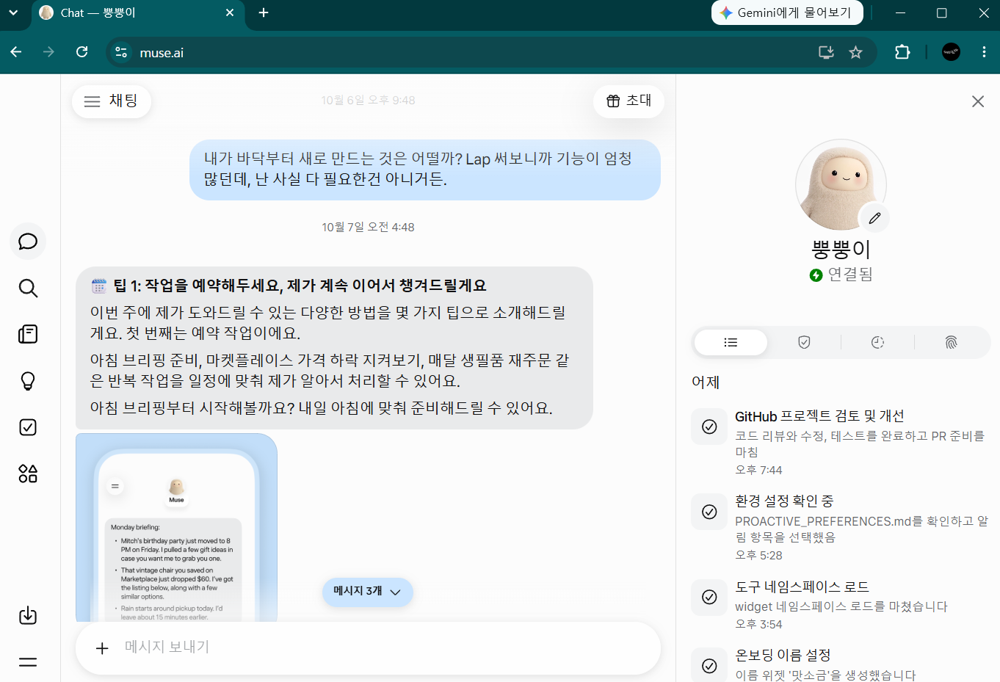

요즘 핫한 dots와 muse를 연결했습니다. 써봐야지하면서도 미뤄오다가 APUSM a.k.a 에이전트 파워 유저 스터디 모임에서 발표하기로 해서 간신히 움직였네요. 나이드니까 움직이는게 쉽지 않네요. 후...

## dots는 대체 어디에

dots 생성부터 시작했습니다. 저는 codex pro 사용자라서 다들 무료로 사용할 수 있는줄 알았는데, pro부터 가능하다네요. pro 결제하세요. 가속 노화가 옵니다.

요즘 gpt와 codex의 경계가 매우 모호해졌습니다. 웹과 앱의 사용성도 거의 비슷해져서 사실 헷갈릴때가 종종있어요. 모바일 앱은 또 조금 달라서 그것도 헷갈립니다. 기본적으로 웹은 사용 기록이나 프로젝트가 그대로 유지되니까 큰 혼란은 없는데, codex는 설치된 PC마다 달라서 조금 헷갈립니다. PC에서 작업하던걸 다른 PC에서 이어가려면 git 원격 레포에 작업한 것을 올리고 마치는 것이 중요한데, dots는 오히려 그게 편하네요. 애초에 나한테 속하지 않아서요. dots는 그냥 대화만 가능한거죠. 언제, 어디서나 같은 모습으로!

dots는 클라우드에 있고, 저랑은 그냥 앱과 웹으로 대화만 합니다. 어떻게 asset을 주고 받을 수 있는지 궁금한데, 흠...다음 기회에ㅎ

dots를 연결해서 이것 저것 일을 시켜놨는데, 어느 정도 정리가 되면 공유 드릴게요 우선 제 dots의 이름은 쪼쪼입니다 😎

## muse는 영국에 있네

우선 muse는 한국에 서비스 시작을 안했는데, 그래도 사용할 수 있더라구요. 저도 회사 지인분한테 들었는데 쪼쪼를 이용하면 muse.ai 계정을 만들 수 있다는 거예요. 그래서 얼른 해 봤습니다. 일단 muse.ai는 앱에서 사용할 수 있는데 앱에서 사용하려면 vpn 을 거쳐야 돼요. 근데 VPN 거치지 않고도 웹으로 [muse.ai URL](https://muse.ai/) 접속하면 사용할 수 있어요. 저는 일단 그렇게 사용해 보겠습니다.

생각보다 어렵지 않게 연결할 수 있었고요. 동의까지 쪼쪼가 알아서 다 해줍니다.ㅋ

제가 만든 muse 이름은 뿡뿡이로 했습니다. 뿡뿡이ㅋㅋ 뿡뿡이한테는 쪼쪼랑 비슷하게 일을 몇 가지 주려고 해요. 과연 잘 해낼 수 있는지 궁금하기도 하지만 무료라고 하니까 얼른 좀 써 보려고 합니다.~~양잿물 정신!!!~~ 시킨 일들을 잘 해내는지 한번 경험해보고 공유해 드리겠습니다.

오늘은 일단 제가 뿡뿡이와 쪼쪼을 만나게 된 이야기를 짧게 공유 드렸는데 다음에는 뿡뿡이와 쪼쪼에게 시킨 일들이 어떤 것이 있는지 한번 공유 드릴게요.
