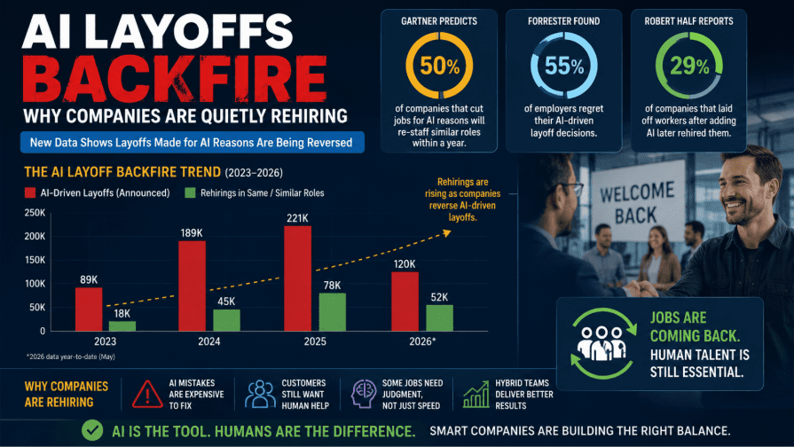

연초에는 토큰 맥싱이라는 말이 뜨거웠습니다. AI를 많이 써라. 토큰을 많이 쓰는 사람이 일을 잘하는 사람이다. 잠깐이지만, 금방 미쳤다는 반응이 있었고, 토큰 사용량 리더보드가 금방 내려갔쥬.

그러다가 밸류 맥싱이라는 말이 주목받기 시작했습니다. 얼마나 썼는지보다 무슨 가치를 만들었는지가 중요하다는 겁니다. [IBM에서도 이런 전환을 다룬 글](https://www.ibm.com/think/insights/tokenmaxxing-dead-long-live-valuemaxxing)이 나왔고, 이제는 경영 기여를 증명하라고 합니다.😲

회사에서 있을 수 있는 당연한 이야기입니다. 

그런데 저는 이 당연한 이야기에서 두가지 생각을 해봤습니다. **많이 써보지도 않고 잘 쓰는 게 가능한가? 개인이 갑자기 얼마나 더 많은 성과를 낼 수 있을까?**

## 고기도 먹어 본 사람이 잘 먹는다

흔한 비유인데, 토큰 좀 태워서 Agent 굴려 본 사람들이 토큰을 많이 사용하는 것은 확실합니다. 물론, 많이 사용하는 것과 잘 쓰는 것은 다른 이야기일 수 있습니다.

많은 회사가 초기에 토큰을 많이 사용하는 것을 장려한 것은 변화를 두려워하지 말고 적극적으로 혁신을 이뤄내길 바랐기 때문입니다. 일종의 유인책이죠.

사람들은 원래 하던 일 중에 가장 설명하기 쉬운 것부터 시켰습니다. 메일 요약, 문장 다듬기, 번역 같은 것과 대시보드, 자동화 시스템을 많이 양산했습니다. 그것도 중복으로ㅋ

토큰 많이 사용하는 것이 무조건 적으로 장려할 만한 일은 아니지만 분명히 필요한 지원이라고 생각합니다. 단순히 토큰 사용량을 올리려고 치팅을 하는 것이 아니라면, **배드민턴 선수가 셔틀콕 망가질까봐 스매싱 연습을 줄이는 일은 없어야** 한다고 생각합니다. 아직 어려운 기술을 연마하지 못했는데 연습을 중단시키는 일은 없어야 합니다.

## 프로모션은 짧다

앞에서 유인책이라고 말했는데, 일종의 프로모션입니다. 그래 한 번 토큰을 사용해서 생상성을 개선해 보세요. 잠깐 지원을 해주는 것이죠. 잠깐!

안타깝게도 프로모션은 짧게 끝났습니다. 이제 조직에서는 성과를 원합니다. 이 당연한 순리를 이해하지 못하는 회사원이 참 많습니다.

사실 여기서부터 진짜 리더의 고민이 시작됩니다. 연습 게임이 끝나고 본 게임이 시작하면, 리더가 더 많이 바빠질 수 밖에 없거든요.

이제 막, 토큰에 달콤함을 느끼던 찰나에 영수증을 제출하라고 하니 참으로 난감합니다.

아직 일하는 방법을 배우는 중인데, 벌써 효율을 최적화하는 것이 맞냐는 항의도 있고, 너무 일찍 효율을 요구하면 사람들은 확실한 일만 하게 되는 것도 현실입니다. 아직 계속 도전할 것이 많은데, 벌써 도전적인 일을 멈추게 될까봐 걱정도 됩니다. **스매싱은 마스터하지 못한채 시합에 나가게 생겼습니다.**

그래도 성과를 가져와야 하는 것이 현실입니다. 배우는 중이니 조금만 기다려주세요라는 부탁을 챙기는 것도 어려운 기술 연마에 더 많이 투자하는 것도 이제는 리더의 몫이 되었습니다. 조직은 항상 리더에게 어려운 일을 맡깁니다. 성과를 챙기면서 성장하라니...후...

## Output은 멀고 Input은 가깝다

토큰에 대한 것은 앞에서 정리가 된것 같네요.

> 토큰은 필요하다. 아주 많이~ 토큰은 꽁짜가 아니다. 성과가 있는 곳에 토큰을 지원한다.

논란의 여지가 없는 원초적인 내용이네요.

리더가 생산성을 높이려면 크게 두 방향이 있습니다. 투입하는 시간이나 비용을 줄이거나, 결과물의 양이나 품질을 높이거나요. Input을 줄이거나 Output을 늘리는 겁니다.

근데, **토큰을 사용해서 만들어내는 단기간의 성과는 대부분 Input을 줄이는 쪽**입니다. 그것이 문제입니다. Input을 줄이는 것에는 한계가 있거든요. 그에 반해 AX로 기대하는 생산성 향상 효과는 최소 3배부터 시작합니다.ㅎㄷㄷ

예를 들어 개발팀이 AI를 잘 써서 개발 속도가 두 배가 됐다고 해보겠습니다. 그러면 제품도 두 배로 많이 출시할 수 있을까요?

만들 것이 정해져 있어야 하고, 기획도 나와야 하고, 검토와 승인도 받아야 합니다. 고객에게 알리고 운영할 준비도 해야 하고요. 개발팀만 빨라졌는데 다른 과정이 그대로라면, 다음 단계 앞에 일이 쌓일 수 있습니다.

분석 보고서도 마찬가지입니다. 보고서를 열 배로 만들 수 있다고 해서 의사결정을 열 배로 할 수 있는 것은 아니죠. 읽는 사람은 그대로인데 보고서만 열 배가 되면... 그 사람도 AI를 써야겠네요ㅎ 그래도 무엇을 결정하고 실행할지가 남습니다.

즉, **개별 조직의 생산성이 올라가는 것과 회사 전체의 성과가 늘어나는 것은 다른 문제입니다.** 결과를 실제 가치로 연결하려면 다른 조직도 함께 움직여야 합니다. 업무를 넘기는 방식과 결정하는 속도도 바뀌어야 하고요. 팀장 한 명이 열심히 한다고 다 해결할 수 있는 일이 아닙니다. ~~그걸 모르고 당장 경영 성과를 논해서는 안됩니다~~

반면 투입을 줄이는 일은 상대적으로 내 손에 있습니다. 예산을 줄이거나, 채용을 멈추거나, 인원을 줄이면 숫자가 바로 보입니다. 다른 조직의 변화까지 기다리지 않아도 되고요.

성과를 보여줘야 하는데 Output은 내 마음대로 늘릴 수 없으니, Input을 줄이는 쪽으로 가게 됩니다. 그 선택이 왜 나오는지는 이해합니다. **다만 AX 혁신이 그렇게 진행되는 것이 맞을까요?**

## 리더는 일을 3배 더 가져와야 한다

기본적으로 저는 AX를 위해서 리더가 일을 3~5배 이상 더 가져와야 한다고 생각합니다. 일을 가져와야 토큰을 확보할 수 있고, 확보한 토큰으로 성장과 성과를 동시에 달설 할 수 있습니다. 

그것은 마치 회사가 필연적으로 성장해야 하는 것과 비슷하다고 생각합니다. 차이가 있다면 **기존에는 인력을 확충하고 조직을 크게 키웠다면, 이제는 토큰을 확보하고 성과를 확대**하는 것이 다릅니다. 동일 조직에서 일을 갑자기 3배 늘리는 것은 단순히 Input을 줄이는 것만으로는 안되기 때문에, Output을 늘리는 것도 같이 해야 합니다.

그게 가능할까요? 말이 되는걸까요? 모르겠습니다. 무책임하지만 저도 답을 모르고, 조직마다 상황이 달라서 정해진 답도 없겠지만, 중요한 것은 **AX 목표를 도전적으로 수립하고 조직 전체가 혁신을 함께 이루지 않으면 AX 속도에 맞춰서 혁신을 이룰 수 없으며, 그것은 비싼 토큰 낭비, 기회 소진, 부분 병목으로 인한 성장 정체로 이어질 것이라고 생각합니다.**

## 아낀 시간으로 무엇을 더 했는가

AX시대에 리더가 해야 할 일은 더 어려워지는 것 같습니다. 토큰을 지원하고 많이 쓰라고 독려하는 데서 끝나지 않아요. AI로 생긴 여력을 쓸 만한 일을 찾아야 합니다.

[Bytereviewer의 「AI Layoff Backfire」](https://www.bytereviewer.com/ai-layoff-backfire-why-companies-are-quietly-rehiring/)에서는 당장 감원에만 집중했다가 다시 재고용하는 사례에 대해서 다루고 있는데, 줄이는 것에만 집중할 경우 발생하는 문제를 다시 생각해 보게 됩니다.

[EY의 미국 고위 의사결정자 설문](https://www.ey.com/en_us/newsroom/2025/12/ai-driven-productivity-is-fueling-reinvestment-over-workforce-reductions)에서 AI 투자로 생산성 향상을 경험한 조직 중 인원 감소로 이어졌다는 응답은 17%였습니다. 연구개발에 재투자했다는 응답은 39%, 직원 역량 개발은 38%였고요. 확보한 여력을 다음 일을 할 능력에 다시 쓰는 겁니다.

시간이 없어서 미뤘던 고객 문제는 없는지. 검토할 사람이 부족해서 접었던 아이디어는 없는지. 늘 일정에 밀려 생략했던 품질 점검은 없는지요. 더 많은 일을 한다고 해서 문서와 회의만 늘어나면 곤란하니까, 실제로 필요한 일인지도 같이 봐야겠죠.

[BCG의 분석](https://www.bcg.com/publications/2026/how-ai-leaders-create-competitive-advantage)을 보면 AI 선도 기업들은 생산성 향상으로 얻은 여력을 사업 확장과 새로운 기회에 재투자한다고 합니다. 저는 이 방향이 더 마음에 들어요. 만드는 능력이 커졌으면, 이제 무엇을 더 만들 수 있는지도 살펴봐야겠죠.

[McKinsey의 글](https://www.mckinsey.com/capabilities/strategy-and-corporate-finance/our-insights/where-ai-will-create-value-and-where-it-wont)은 여기서 한 걸음 더 갑니다. 경쟁사도 효율을 높이면 생산성 개선만으로 얻은 우위는 오래가기 어렵고, 제품과 서비스, 사업모델을 바꾸는 데서 성장 기회를 찾아야 한다는 것입니다. 같은 일을 빨리 끝낸 다음에는, 전에는 비용 때문에 제공하지 못했던 서비스나 대응하지 못했던 고객까지 생각해볼 수 있겠죠. **일을 더 할 수 있게 된 만큼 사업의 가능성도 넓혀보자는 겁니다.**

이런 생각을 하다보면 AX야 말로 정말 탑다운으로 혁신이 진행되어야 하는 것이 아닌가 싶은데, 현실은 여전히 바닥부터, 생산성 개선부터 진행되는 것 같아서 아쉬움이 남습니다.

그래도 제가 서있는 곳에서 할 수 있는 것부터 혁신을 만들어 봐야죠. 광풍의 AX시대 리더분들 모두 응원합니다!😁
